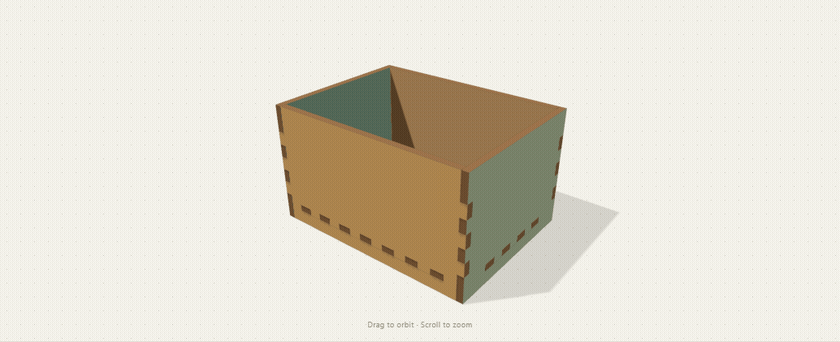
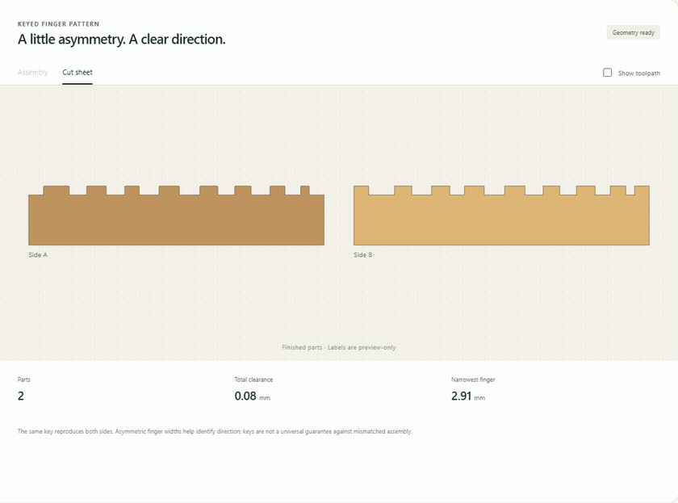
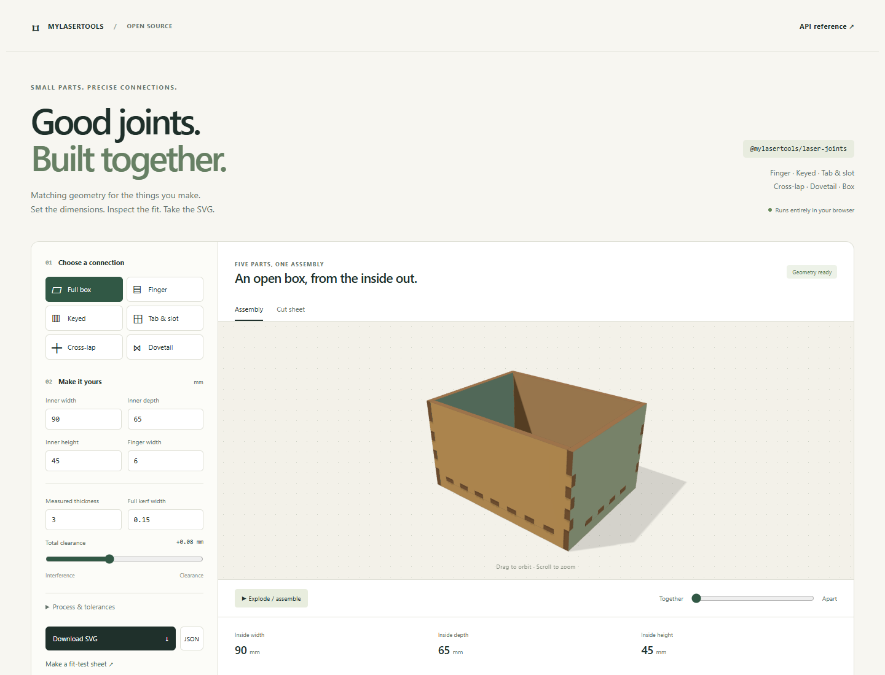

# @mylasertools/laser-joints

**Matching laser-cut joints for people and their generators.**

[Interactive demo](https://mylasertools-com.github.io/laser-joints/demo/) · [API reference](docs/API.md) · [Report an issue](https://github.com/mylasertools-com/laser-joints/issues)

Generate both sides together, inspect the finished dimensions, and export closed SVG cutting paths. Includes finger joints, keyed fingers, tab-and-slot joints, cross-laps, dovetail splices, and a complete five-panel box.



TypeScript · ESM + CommonJS · Browser + Node 20+ · MIT · No runtime install dependencies

Clipper2 is bundled for polygon operations. The npm core does not include Three.js or the demo.

## Start here

Install from npm:

```sh
npm install @mylasertools/laser-joints
```

The library, CLI, demo, scripts, and tests are authored in strict TypeScript. The package ships compiled JavaScript for browsers and Node.js, with generated TypeScript declarations for both module formats.

```ts
import { createFingerJointPair, toSvg } from '@mylasertools/laser-joints';

const joint = createFingerJointPair({
  lengthMm: 100,
  thicknessMm: 3, // measured sheet thickness
  kerfMm: 0.15, // FULL beam width, not half-width
  clearanceMm: 0.08, // TOTAL female-minus-male dimension
  targetFingerWidthMm: 6,
  leadInMm: 0.25,
});

const svg = toSvg(joint);
console.log(joint.fits.finger, joint.issues);
```

All values above are illustrative. Calibrate thickness, kerf, clearance and process limits on your own material.

## What you can build

| Function                            | Connection                    | Useful detail                                                                  |
| ----------------------------------- | ----------------------------- | ------------------------------------------------------------------------------ |
| `createFingerJointPair`             | Alternating fingers           | Shared pattern, unequal sheet thicknesses, separate kerfs, tip chamfers        |
| Same function with `key`            | Asymmetric keyed fingers      | Reproducible varying widths and visibly different end fingers                  |
| `createTabSlotJoint`                | Sheet tab into closed mortise | Uses **sheet thickness** for slot height; optional rounded end relief          |
| `createCrossLapJoint`               | Two intersecting panels       | Opposing half-depth slots, independent depth allowance                         |
| `createDovetailJointPair`           | Flared coplanar splice        | Retaining silhouette; insert from above the sheet plane                        |
| `createBox`                         | Open box with raised bottom   | Five closed panels, matching corner fingers and bottom mortises, 3D transforms |
| `createFitTest`                     | Clearance sweep               | Ordered coupon pairs, cut-only SVG and a separate manifest                     |
| `estimateFit`, `placeEdge`, `toSvg` | Generator utilities           | Worst-case fit ranges, rigid edge placement, explicit machining metadata       |

### A small signature: keyed fingers

```ts
const keyed = createFingerJointPair({
  lengthMm: 100,
  thicknessMm: 3,
  kerfMm: 0.15,
  clearanceMm: 0.08,
  key: 'front-left',
});
```



The key changes the cell widths while keeping both sides matched. It can help distinguish panel orientation without adding engraving. Inspect `pattern.fingers` for the actual coordinates. This is an assembly aid, not a guarantee that every different key is mechanically incompatible. The default box uses standard fingers.

### A complete box

```ts
import { createBox, toSvg } from '@mylasertools/laser-joints';

const box = createBox({
  innerWidthMm: 90,
  innerDepthMm: 65,
  innerHeightMm: 45,
  thicknessMm: 3,
  kerfMm: 0.15,
  clearanceMm: 0.08,
});
const cutSheet = toSvg(box);
// Each panel includes nominal contours, toolpaths, and a 3D assembly transform.
```

## See it work

```sh
npm run build:demo
npm run demo
# Open http://127.0.0.1:4178/demo/
```

The demo runs locally without external fonts, analytics, CDN scripts, or API calls. Change all six examples, orbit/explode the box, inspect toolpaths, download SVG/JSON, and make a fit-test sheet. Once built, `demo/` can be served statically alongside `docs/`. The animation is an exploded inspection view; the tested insertion sequence is documented separately.



## Kerf exactly once

- `kerfMm` is full cut width. Geometry mode offsets outlines outward by half-kerf and holes inward by half-kerf. **Use zero additional CAM offset.**
- `compensation: 'cam'` leaves contours nominal and reports the required half-kerf offsets. Apply them in CAM according to outer/hole roles.
- `clearanceMm` is total female dimension minus male dimension, not per-edge clearance. Positive gives space; negative requests interference and emits a warning.
- Finished geometry and cutting centerlines are separate. Open edge profiles are always nominal: close the full part before offsetting.
- Exported SVGs contain only cut contours. Preview labels never become unintended cuts. Metadata records dimensions, placement, machining mode and fit information.

## For agents and integrations

Use the typed API or the JSON CLI. Unknown option names, non-finite numbers, impossible dimensions, erased features, and requested minimum-feature/web violations fail with structured `JointError` diagnostics. Explicit kerf and clearance are required; the library never guesses a material fit.

```sh
laser-joints box examples/box.json --format svg --output box.svg
laser-joints finger examples/keyed-fingers.json --format json
laser-joints calibration examples/calibration.json --format svg --output fit.svg
```

Use `-` for stdin. Existing output files are never overwritten. JSON is the default; SVG diagnostics go to stderr. See [agent integration](docs/AGENT-INTEGRATION.md).

## Documentation and validation

- [API reference](docs/API.md) — options, defaults, return values and error codes
- [Geometry and assembly conventions](docs/DESIGN.md) — fit equations, material direction, relief and limitations
- [Validation evidence](docs/VALIDATION.md) — dimensional, assembly, browser and packed-consumer checks
- [Upstream decisions](docs/UPSTREAM.md) — Clipper2, BoxBurner, and fabrication references
- [Release and contributor guide](docs/CONTRIBUTING.md)
- [Seven runnable examples](examples/) and their generated SVGs/JSON

```sh
npm run check
npm run examples
npm run test:package
npx playwright install chromium firefox webkit
npm run test:browser
```

The tests check ideal geometry and simulated assembly. They do not establish strength, compensate taper/grain/coatings, or replace physical fit coupons. No hardware cuts are claimed. This release supports the joint families above, not every form of joinery, a nesting engine, or arbitrary polygon CAM.

Original package code is [MIT](LICENSE). Bundled/adapted components retain their [third-party licenses](THIRD-PARTY-NOTICES.md).
